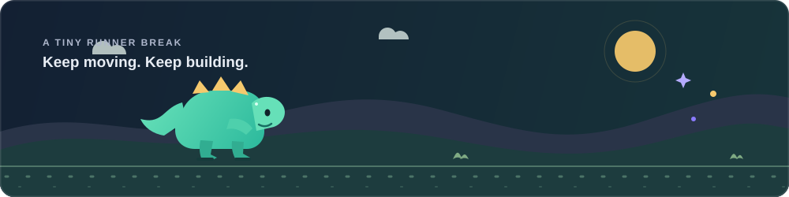
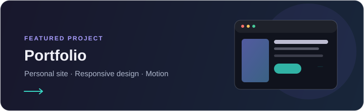
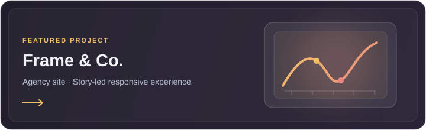
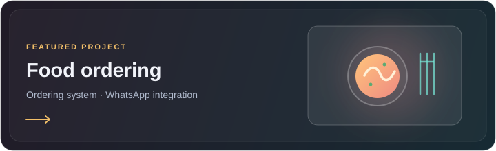

 

  

## About me

I’m Tarun, a frontend-leaning full-stack developer who enjoys turning ideas into polished, responsive web experiences. I work with modern frontend tools and build practical applications across the stack.

  

## Tech I use

  

## Selected work

<table>
  <tr>
    <td width="50%" valign="top">
      
      
A personal portfolio built with HTML, CSS and JavaScript, with a focus on responsive layout and motion.

      HTML · CSS · JavaScript
    </td>
    <td width="50%" valign="top">
      
      
Leave management with employee and manager roles, approval workflows and dashboards.

      React · Node.js · Express · PostgreSQL
    </td>
  </tr>
  <tr>
    <td width="50%" valign="top">
      
      
A responsive agency site combining clear storytelling, subtle motion and a component-based structure.

      JavaScript · Responsive UI · Motion
    </td>
    <td width="50%" valign="top">
      
      
A food ordering system connecting a React frontend and FastAPI backend with WhatsApp integration.

      React · FastAPI · PostgreSQL · Twilio
    </td>
  </tr>
</table>

## GitHub at a glance

  

  

 

*Thanks for stopping by — feel free to explore my projects.*

