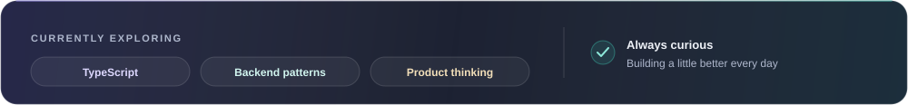

<!-- Place this README.md and the assets/ folder in your repo: tarun7982/tarun7982 -->

 

  

  

  

<h3>Tech Stack</h3>

  

  

<h3>Featured Projects</h3>

| Project | Description | Stack |
|:--|:--|:--|
| 🌐 [**Portfolio**](https://YOUR-PORTFOLIO-URL) | Personal portfolio with smooth animations and responsive layout | `HTML` `CSS` `JavaScript` |
| ⚛️ [**Project Two**](https://github.com/tarun7982/REPO-NAME) | One-line description of what it does | `React` |
| 🧩 [**Project Three**](https://github.com/tarun7982/REPO-NAME) | One-line description of what it does | `JavaScript` |

 

<h3>GitHub Stats</h3>

 

  

Thanks for stopping by ✌️

